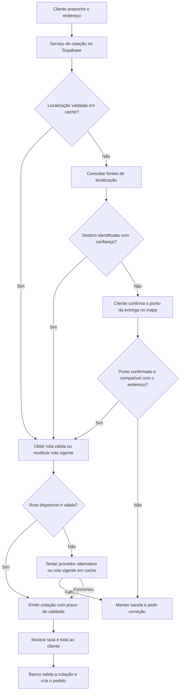

# Entrega confiável: diagnóstico e proposta de implementação

Data: 18/10/2026. Base do diagnóstico: `405ed13`. A implementação foi solicitada pelo dono e realizada após esta análise: serviço de cotação, tabelas privadas, cache, adaptadores Google/CEP/OpenRouteService, confirmação no mapa, garantia na criação do pedido e controles da equipe. **A ativação em produção aguarda a chave do provedor de rotas.** Consulte [operação e configuração](ENTREGA-OPERACAO.md). As seções seguintes preservam a justificativa e os critérios da solução.

## Resultado da investigação

Os pedidos 0045, 0047, 0050 e 0051 foram gravados com `distancia_km = null` e `taxa_entrega = null`. Os totais não incluíram entrega. O problema ocorre antes da impressão: o banco aceita essa entrada. Os valores e os endereços dos pedidos históricos foram preservados.

A investigação inicial encontrou buscas vazias no Nominatim. A comparação posterior com outra base revelou uma causa mais específica: existem diferenças entre os nomes postais e os nomes das vias no mapa. Portanto, busca vazia não prova que a rua esteja ausente do mapa.

| Nome postal | Via encontrada na consulta reversa das coordenadas da segunda base |
|---|---|
| Rua Vitório Favalli | Rua Vitório Favale |
| Rua Professor Jeremia | Rua Professor Jeremias |
| Rua Camilo Scurço | Rua Camilo Escurco |

O quarto caso tinha número sem vírgula antes e complemento depois. A correção publicada em `405ed13` remove esses trechos somente das tentativas de busca, preservando o endereço completo no pedido. O teste no site publicado passou a calcular R$ 12,00 para o endereço testado; nenhum valor foi adicionado ao pedido antigo.

### Comparação realizada com os quatro CEPs

- **ViaCEP:** retornou os dados postais. Não fornece a localização necessária à rota.
- **Nominatim atual:** três buscas por nome continuaram vazias; o quarto endereço passou a funcionar após a correção do complemento.
- **AwesomeAPI CEP:** retornou coordenadas nos quatro casos. A consulta reversa encontrou vias compatíveis com os nomes acima e a via esperada no quarto caso. Isso fornece candidatos úteis; não comprova o número da casa nem cobertura universal. O CEP retornado pelo mapa também divergiu do postal em parte dos casos.
- **BrasilAPI CEP v2:** retornou exatamente o mesmo ponto para dois CEPs de ruas distintas. O código oficial permite recorrer à localização da cidade quando não encontra a rua. Por isso, suas coordenadas não podem ser aceitas automaticamente como endereço da entrega.

Foram consultados somente os casos envolvidos, sem cadastrar pedidos de teste em produção. Não foi feita validação presencial, nem comparação porta a porta por um entregador. As evidências explicam a reprodução atual; não existem registros das respostas dos serviços recebidas pelos celulares no momento dos pedidos antigos.

## Fragilidades do código atual

1. `src/app.js` coordena CEP, geocodificação, rota, recuperação e estados do formulário. As chamadas dependem do navegador e de serviços públicos externos.
2. O cache de distâncias fica apenas na memória da página. Outro aparelho ou uma recarga repete as consultas.
3. O intervalo de 1,1 s do Nominatim vale por página, mas o limite oficial vale pela soma dos usuários da aplicação. É necessário controle compartilhado se esse serviço continuar sendo usado.
4. `entradaDoPedido()` envia `distanciaKm` informada pelo navegador. `criar_pedido()` valida o intervalo numérico e refaz a multiplicação, mas não verifica a origem da distância ou sua associação com o endereço.
5. Uma falha definitiva permite enviar a entrega com distância e taxa vazias. CEP inválido/endereço digitado manualmente também segue por esse caminho.
6. Os erros externos terminam no mesmo estado `falha`; falta distinguir cobertura, baixa precisão, limite de uso e indisponibilidade para investigar reincidências.
7. O endpoint OSRM utilizado é um servidor de demonstração. Sua documentação restringe o uso a casos razoáveis e não comerciais e não oferece garantias de disponibilidade, latência ou atualização. Ele precisa ser substituído como dependência de produção.
8. O ponto de origem do truck é descrito no CONFIG como coordenada do trecho da rua, pendente de confirmação exata. Esse ponto também precisa ser validado para melhorar a precisão da cobrança.

## Recomendação

Criar um serviço próprio de **cotação de entrega** no Supabase, com fornecedores de localização e rota isolados por adaptadores. Manter Vite, JS, Supabase, Vercel e o contrato `ML.store`; não há necessidade de trocar o framework ou criar microsserviços separados para cada consulta.

O objetivo verificável é: **todo novo pedido de entrega aceito tem cotação válida, taxa definida e total incluindo a taxa**. Serviços de mapas podem falhar; a aplicação precisa recuperar a consulta ou oferecer uma forma de confirmar o destino. Na ausência de uma cotação válida, preserva a sacola e não registra uma entrega com valor incompleto.

### Fluxo

### Localização e recuperação

- Consultar o endereço completo com número. Avaliar a precisão que o fornecedor informa e conferir município/UF e endereço retornado; um HTTP 200 ou uma coordenada não bastam.
- Usar dados de CEP com coordenadas como segunda fonte de candidatos. Conferir CEP, município/UF, logradouro e coerência geográfica. Nome parecido ou ponto próximo isoladamente não prova correspondência. Não transformar sugestões de grafia em associações permanentes automaticamente.
- Quando houver divergência ou só houver localização por rua/CEP, pedir confirmação do ponto da **entrega** no mapa. Não adotar automaticamente o centro do município nem a posição atual do aparelho. GPS é opcional, acionado pelo cliente, e requer confirmação: ele pode estar comprando para outro endereço.
- Salvar a localização confirmada para aquele endereço e número; guardar origem, precisão, confirmação e data. O próximo pedido pode reaproveitá-la. Não tornar nomes, telefones ou endereços de outros clientes acessíveis para consulta por CEP/telefone.
- Aceitar correções de vias pela equipe em cadastro próprio, com procedência e revisão, se necessário. Não colocar exceções dos quatro pedidos em condicionais do checkout.
- Usar limite de tempo total, repetição limitada para erros temporários e provedor alternativo. Uma fonte indisponível não deve provocar uma sequência indefinida de tentativas. Não repetir indefinidamente um resultado "endereço não encontrado".
- Troca de endereço cancela a cotação anterior. Uma consulta antiga não pode atualizar a taxa do endereço novo.

### Contrato proposto entre cliente e servidor

Adicionar `ML.store.cotarEntrega(...)`. O checkout fala com a store; ela chama a Edge Function. Normalização, validação e resolução ficam em módulos pequenos, testáveis sem navegador e com dependências injetáveis (`fetch`, relógio e provedores). Os adaptadores retornam um formato comum, sem espalhar detalhes de Google, CEP ou OSM pelo checkout.

Entrada da cotação: CEP, endereço preenchido e eventual ponto confirmado. Nome, telefone e itens da sacola não são necessários para localizar o destino.

Resultado: identificador opaco e imprevisível, distância, taxa, vencimento e estado de confirmação. Os estados de falha distinguem, por exemplo, `cep_invalido`, `localizacao_ambigua`, `rota_indisponivel`, `fora_do_alcance` e `cotacao_expirada`. Não apresentar detalhes internos dos fornecedores na interface.

O servidor guarda a cotação vinculada ao endereço normalizado, coordenadas, origem do truck, perfil da rota, configuração da taxa e validade. Para o primeiro corte, propor validade curta de 15 minutos, a validar no uso. O identificador é um comprovante de cotação, não uma distância ou taxa assinada pelo navegador.

No envio, `criar_pedido`:

1. Preserva a idempotência: repetição de um pedido já aceito devolve o mesmo pedido, mesmo se a cotação tiver vencido depois.
2. Para uma nova entrega, verifica cotação existente, ainda válida, do endereço informado, com a origem e a configuração de preço vigentes.
3. Obtém a distância da cotação persistida; deixa de confiar em `distanciaKm` enviada pelo cliente.
4. Refaz a regra vigente de km arredondado para cima × taxa por km + valor fixo, grava taxa e total na mesma transação e associa a cotação ao pedido.
5. Se precisar recalcular e o valor mudar, exige mostrar o novo total e nova confirmação do cliente. Não aumenta a cobrança silenciosamente após o clique.
6. Mantém retirada sem taxa e permite operar os pedidos históricos que já tenham taxa vazia.

A garantia deve ficar na criação do pedido, não apenas no botão do formulário. Não aplicar uma restrição global ingênua de `taxa_entrega is not null`: ela também poderia impedir atualizações de status dos pedidos antigos sem taxa.

### Cache, segurança e operação

- Separar localização, rota e cotação. Chave de localização considera endereço/número e fonte; chave de rota considera origem, destino e perfil; cotação considera também a versão da regra da taxa. Uma mudança da taxa não exige geocodificar a rua novamente.
- Definir validade por tipo de dado e pelas condições do fornecedor. Cache não torna um resultado impreciso confiável nem permite armazenar indefinidamente dados que o fornecedor restringe.
- Localizações confirmadas e cotações ficam privadas no banco. Usar RLS e privilégios mínimos; escrita pelo backend/equipe autorizada e acesso ao próprio resultado por identificador seguro. Nunca expor uma consulta geral de endereços ou credenciais administrativas.
- Chaves externas ficam nos secrets da Edge Function. Provedores/endpoints vêm de configuração controlada no servidor; não aceitar URL arbitrária enviada pelo navegador.
- Limitar chamadas e concorrência de forma compartilhada, deduplicar consultas simultâneas ao mesmo endereço e impor limites de consumo. CORS sozinho não protege um endpoint público de abuso.
- Registrar identificador da tentativa, etapa, fonte, duração, precisão e código de falha. Evitar nome, telefone, endereço completo e coordenadas exatas nos logs de diagnóstico. Manter dados sensíveis necessários apenas nas tabelas privadas, com política de retenção.
- Medir sucesso da primeira consulta, recuperação pela segunda fonte, confirmações manuais e tempo até a cotação. Alertar para aumento de falhas sem depender de descobrir o problema numa comanda.

## Alternativas de infraestrutura

| Opção | Vantagem | Limitação | Avaliação |
|---|---|---|---|
| Só acrescentar uma API pública de CEP/mapa no navegador | Pode recuperar os casos de grafia com poucas mudanças | Mantém dependência do celular, ausência de cotação confiável e falhas dos servidores públicos | Melhoria pontual; insuficiente como solução final |
| Cotação própria + provedor gerenciado de localização/rotas + recuperação e cache | Pouca manutenção operacional, fornecedores substituíveis e cotação controlada pelo negócio | Requer conta/chave, validação de cobertura, termos e limites de consumo | Recomendação para o volume atual |
| Cotação própria + geocodificador e roteador hospedados pela empresa | Maior controle de infraestrutura e armazenamento dos dados próprios | Exige hospedagem, atualização da malha, monitoramento e recuperação; mesma base OSM ainda pode conter nomes divergentes | Possível evolução; custo operacional maior |
| Tabela de taxas por CEP/bairro/faixa aprovada pelo dono | Cobrança determinística, sem serviço de mapas a cada pedido | Altera a regra comercial atual, baseada em km de rota; manutenção da tabela | Só usar se o dono decidir mudar a regra |

Google Maps Geocoding + Routes é uma opção gerenciada a avaliar no mesmo conjunto de testes. Não foi testada nesta análise, pois não há chave configurada no repositório. Não assumir que cobre todos os endereços, que é gratuito ou que seus resultados podem ser guardados indefinidamente. A confirmação em mapa e o cache precisam respeitar as regras de exibição/armazenamento do fornecedor; não misturar dados Google em um mapa de outra plataforma sem verificar as condições aplicáveis.

Na tabela oficial consultada em 18/10, **Geocoding** e **Routes: Compute Routes Essentials** têm, cada um, franquia mensal de 10.000 eventos e primeira faixa paga de US$ 5 por 1.000 eventos. Por exemplo, 1.000 cotações no mês com exatamente uma consulta de cada API ficariam dentro dessas duas franquias. Isso não é estimativa da fatura real: tentativas, visitas sem compra, mapa, autocomplete e recursos de outros SKUs precisam entrar no dimensionamento. Verificar enquadramento, conta de faturamento e preços na configuração; impor cotas no provedor e teto de consumo no backend, além de alertas. Não foi habilitado faturamento nesta análise.

AwesomeAPI é uma candidata comprovada para recuperar coordenadas dos quatro CEPs, mas o teste do endpoint público não comprova SLA, precisão no número da casa ou franquia contratada para CEP. A documentação de chave usa exemplos de cotação de moedas; não extrapolar essa franquia para CEP sem confirmar. É necessário validar os termos e limites da modalidade escolhida.

## Entrega em etapas e critérios de aceite

1. **Núcleo e cotação em homologação:** adaptadores, validação de precisão, persistência privada, rate limit e testes. Confirmar o ponto do truck. Comparar os quatro casos e uma amostra de endereços que já funcionam. Não cobrar valores novos em pedidos históricos.
2. **Checkout e confirmação de localização:** manter o fluxo por telefone e múltiplos endereços; associar cada endereço à sua localização e cotação. Usar confirmação em mapa somente quando necessária. O cabeçalho atual bloqueia geolocalização; alterá-lo de forma restrita ao implementar GPS opcional. Testar também iPhone/WebKit.
3. **Integração e ativação da garantia:** publicar o backend compatível e o cliente antes de exigir a cotação na RPC. Só ativar a exigência quando o caminho de recuperação estiver funcional. Clientes com página antiga precisam receber erro recuperável e instrução de atualização, sem criação de entrega incompleta.
4. **Observação de produção:** conferir taxa de sucesso, uso dos fornecedores, latência, cotação gravada, total do pedido, painel e comanda. Reversão não deve reintroduzir silenciosamente entregas sem taxa: preservar a regra de consistência e tratar a indisponibilidade explicitamente.

Casos obrigatórios de teste:

- Os quatro casos do diagnóstico, incluindo grafias diferentes e complemento no endereço.
- Resposta por cidade/bairro, município errado, coordenadas inválidas, CEP genérico e endereço editado incompatível com o CEP: não cobrar automaticamente como se fosse a porta correta.
- Falha/429/timeout de um fornecedor, recuperação pelo outro, perda total dos fornecedores e cache válido/expirado.
- Troca rápida entre endereços salvos, alteração do número, revogação/recusa de GPS e confirmação do ponto de entrega em outro local.
- Cotação inexistente, adulterada, vencida ou de outro endereço; distância alterada no payload; mudança da taxa ou origem: servidor recusa/requer nova confirmação.
- Clique duplo e queda da resposta após gravação: somente um pedido, recuperável pela idempotência.
- Retirada continua sem taxa. Histórico sem taxa continua visível, imprimível e com mudança de status funcionando.
- Novo pedido de entrega aceito: taxa visível antes do envio, no banco, no total, no painel e na comanda, sem divergência.

## Fontes verificadas

- [Nominatim: política de uso](https://operations.osmfoundation.org/policies/nominatim/): limite compartilhado por aplicação, identificação, atribuição, cache e capacidade de trocar o serviço.
- [OSRM: servidor de demonstração](https://github.com/Project-OSRM/osrm-backend/wiki/Demo-server): restrições e ausência de garantias operacionais.
- [AwesomeAPI: CEP](https://docs.awesomeapi.com.br/api-cep) e [chaves](https://docs.awesomeapi.com.br/instrucoes-api-key.md): formato, coordenadas e configuração.
- [BrasilAPI: resolução de coordenadas](https://github.com/BrasilAPI/BrasilAPI/blob/main/lib/fetchGeocoordinateFromBrazilLocation.js): fallback para coordenadas da cidade.
- [Google: Geocoding](https://developers.google.com/maps/documentation/geocoding/requests-geocoding), [Routes](https://developers.google.com/maps/documentation/routes/compute_route_directions), [políticas de geocodificação](https://developers.google.com/maps/documentation/geocoding/policies) e [preços](https://developers.google.com/maps/billing-and-pricing/pricing).
- [Supabase: Edge Functions](https://supabase.com/docs/guides/functions), [secrets](https://supabase.com/docs/guides/functions/secrets) e [segurança dos dados](https://supabase.com/docs/guides/database/secure-data).

Nenhuma conta paga foi contratada, nenhum provedor novo foi ativado no checkout e nenhuma política de cobrança foi alterada nesta etapa de análise.
